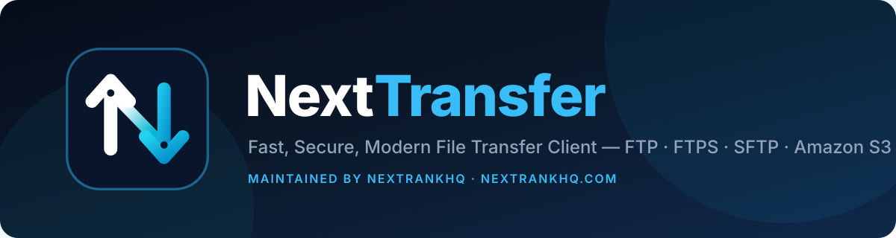

<p align="center">
  
</p>

# NextTransfer

<p align="center">
  <strong>Simple, Fast, Reliable Desktop File Transfer Client for FTP, FTPS, SFTP, and S3 Object Storage</strong><br>
  Developed and maintained by <a href="https://nextrankhq.com/next-transfer"><strong>NextRankHQ</strong></a>
</p>

<p align="center">
  <a href="https://nextrankhq.com/next-transfer">Website & Documentation</a> ·
  <a href="https://github.com/NextRankHQ/nexttransfer/releases">Releases & Downloads</a> ·
  <a href="docs/LINUX-DEVELOPMENT.md">Linux Developer Guide</a> ·
  <a href="https://github.com/NextRankHQ/nexttransfer/issues">Report an Issue</a>
</p>

<p align="center">
  
  
  
  
  
  
  
  
</p>

---

## Overview

**NextTransfer** is a lightweight, free, open-source desktop file-transfer client designed for developers, freelancers, web designers, hosting customers, and small businesses. Built with a fast **Rust (Tauri 2)** backend and a clean **React 18 + TypeScript** dual-pane interface, NextTransfer focuses on doing core server and object-storage transfers simply and reliably.

### Features

- **Core Protocols & S3 Object Storage:**
  - **FTP & FTPS** — Explicit and Implicit TLS 1.2/1.3 (`rustls`), Passive/Active modes, `MLSD`/`MLST` directory listings, and transfer resumption.
  - **SFTP & SCP** — Password, SSH Private Key (`.pem`, Ed25519, RSA), and SSH Agent authentication with strict `known_hosts` verification.
  - **Amazon S3 & S3-Compatible Object Storage** — AWS S3, Cloudflare R2, Backblaze B2, Wasabi, DigitalOcean Spaces, MinIO, Google Cloud Storage, Oracle Cloud, Storj, IDrive e2, Azure Blob, and custom S3 endpoints.
- **Clean Dual-Pane Interface:**
  - Side-by-side Local and Remote file browsers with breadcrumbs, quick search, and drag-and-drop transfers.
  - Connection Manager for organizing saved server profiles and quick connections.
  - Real-time Transfer Queue with upload/download progress, speed indicators, cancellation, and retries.
- **Security First:**
  - **No Plaintext Passwords:** Server passwords, SSH key passphrases, and S3 secret keys are encrypted with **AES-256-GCM** in the local credential vault, backed by the OS native keyring (`libsecret` / KWallet on Linux, Windows Credential Manager, macOS Keychain) or an optional **Argon2id** Master Password.
  - **Strict Verification:** Enforces SSH host-key verification and TLS certificate validation.
  - **Zero Telemetry:** NextTransfer never sends credentials, S3 secrets, filenames, or analytics to NextRankHQ or any third party.

---

## Supported Protocols

| Protocol | Authentication | Capabilities |
|----------|----------------|--------------|
| **FTP** | Username / Password, Anonymous | Passive/Active modes, `MLSD`/`MLST` listings, resume, directory & file management |
| **FTPS** | Explicit TLS (`AUTH TLS`), Implicit TLS | TLS 1.2 / 1.3 via `rustls`, certificate verification, encrypted control & data channels |
| **SFTP / SCP** | Password, SSH Private Key, SSH Agent | Interactive `known_hosts` verification, parallel range downloads, SCP fallback |
| **S3 / Object Storage** | Access Key ID + Secret Access Key, Session Token | Bucket browsing, folder-prefix navigation, multipart large-file uploads, presigned URLs |

---

## Platform Support

| Operating System | Architectures | Release Packages |
|------------------|---------------|------------------|
| **Linux** | `x86_64` | `.AppImage`, `.deb`, `.rpm` |
| **Windows 10 / 11** | `x86_64` | `.msi`, `-setup.exe`, portable `.zip` |
| **macOS** | Apple Silicon (`aarch64`) & Intel (`x86_64`) | `.dmg` |

---

## Installation

### Linux

- **AppImage (Universal):**
  ```bash
  chmod +x NextTransfer_*.AppImage
  ./NextTransfer_*.AppImage
  ```
- **Debian / Ubuntu (`.deb`):**
  ```bash
  sudo apt install ./NextTransfer_*_amd64.deb
  ```
- **Fedora / RHEL / openSUSE (`.rpm`):**
  ```bash
  sudo dnf install ./NextTransfer-*.x86_64.rpm
  ```

### Windows 10 & 11
- Run `NextTransfer_1.0.0_x64-setup.exe` or `NextTransfer_1.0.0_x64_en-US.msi`, or extract `NextTransfer-1.0.0-portable-windows-x64.zip` and run `NextTransfer.exe`.

### macOS
- Open `NextTransfer_1.0.0_aarch64.dmg` (Apple Silicon) or `NextTransfer_1.0.0_x64.dmg` (Intel) and drag **NextTransfer** to `/Applications`.

---

## Development Setup (Linux)

For full Linux setup instructions, see [docs/LINUX-DEVELOPMENT.md](docs/LINUX-DEVELOPMENT.md).

```bash
# 1. Install dependencies
git clone https://github.com/NextRankHQ/nexttransfer.git
cd nexttransfer
npm ci

# 2. Run in development mode
npm run tauri dev

# 3. Typecheck, test, and build frontend
npm run typecheck
npm run test:unit
npm run build

# 4. Build desktop packages (.deb, .rpm, .AppImage)
npm run tauri build
```

---

## Licence & Attribution

**NextTransfer** is free and open-source software licensed under the **GNU General Public License v3.0 or later (`GPL-3.0-or-later`)** — see [LICENSE](LICENSE).

- **Developed & Maintained by:** [NextRankHQ](https://nextrankhq.com/next-transfer) (<https://github.com/NextRankHQ/nexttransfer>)
- **Upstream Attribution:** NextTransfer is a derivative fork of [AeroFTP](https://github.com/axpdev-lab/aeroftp), originally created by **axpdev (axpnet)** and contributors (`Copyright © 2024-2026 axpdev`). All original copyright notices and GPL-3.0-or-later licence terms are preserved.
